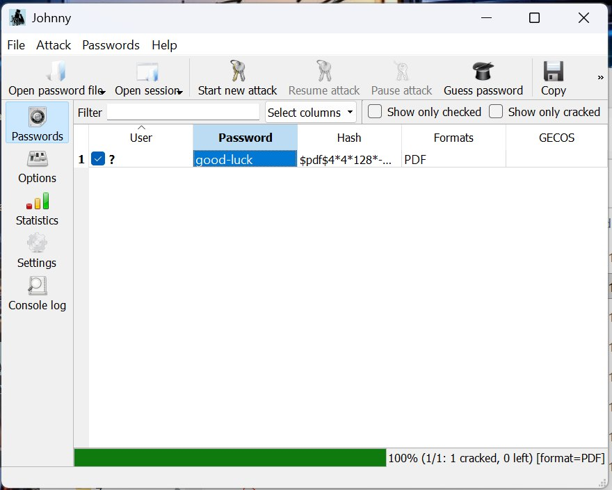

# JOHN-THE-RIPPER-AND-HASH-CRACKER
## Using Johnny and Hash Cracker to crack file passwords

Today I completed the “John the Ripper: The Basics”. 
This helped me understand how password cracking works at a practical level and how attackers (and defenders) test the strength of hashed passwords in real systems.

In simple terms, John the Ripper is a hash-cracking tool used mainly on Linux and windows systems. It does not crack passwords directly. Instead, it tries to match a given hash with possible password values by hashing guesses and comparing the results. This is important because in real systems, passwords are never stored in plain text; they are stored as hashes. When a data breach happens, attackers usually get a file full of hashed passwords, not actual passwords. 
Tools like Johnny are used to test how weak or strong those hashes are.

Johnny mainly works with a file that contains multiple hashes. Once we have that file, we provide John with a wordlist (a list of possible passwords), and it starts hashing those words and comparing them with the target hash. If a match is found, the original password is revealed. This made me understand why weak passwords are such a big risk even when hashing is used.

## JONHNNY ON WINDOWS

Basic cracking using a wordlist
The first and most common method is dictionary-based cracking, where John uses a wordlist such as rockyou.txt and tries each password.

## IDENTIFYING THE HASH TYPE
Before cracking, we need to know which algorithm was used (MD5, SHA1, SHA256, etc.). For this, I used a Hash Calculator.

## HASH CALCULATOR
A hash calculator is a tool that takes any file or text string and runs it through a mathematical algorithm to turn it into a unique, fixed-size string of letters and numbers called a hash value (or checksum).

![image alt]

How It Works

• Deterministic: The exact same input will always generate the exact same hash.
• One-Way: You cannot reverse-engineer or "decrypt" a hash back into the original file or text.
• The Avalanche Effect: If you change even a single character, letter case, or byte in the file, the resulting hash changes completely.
