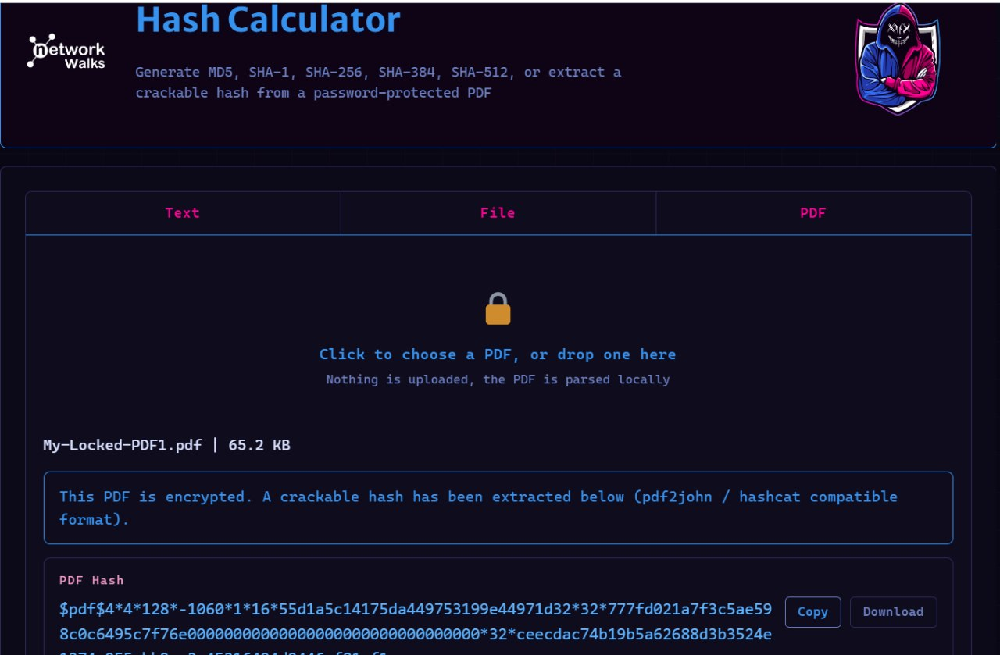

# JOHN-THE-RIPPER-AND-HASH-CRACKER
## HASH RECOVERY AND PASSWORD CRACKING

## Project Overview

This Repository documents the execution of Hash Cracking and Hash Calculations.

The of this lab is to execute and demonstrate cryptographic hash extraction from password protected pdf files or documents and evaluate password strength using dictionary attacks across both Windows, Linux tools and online based security tools. Today I completed the “John the Ripper: The Basics”. 
This helped me understand how password cracking works at a practical level and how attackers (and defenders) test the strength of hashed passwords in real systems.

## Introduction

John the Ripper - is a hash-cracking tool used mainly on Linux and windows systems. It does not crack passwords directly. Instead, it tries to match a given hash with possible password values by hashing guesses and comparing the results. This is important because in real systems, passwords are never stored in plain text; they are stored as hashes. When a data breach happens, attackers usually get a file full of hashed passwords, not actual passwords. 
Tools like Johnny are used to test how weak or strong those hashes are.

Johnny mainly works with a file that contains multiple hashes. Once we have that file, we provide John with a wordlist (a list of possible passwords), and it starts hashing those words and comparing them with the target hash. If a match is found, the original password is revealed. This made me understand why weak passwords are such a big risk even when hashing is used.

## Johnny on Windows

Basic cracking using a wordlist
The first and most common method is dictionary-based cracking, where John uses a wordlist such as rockyou.txt and tries each password.

## Identifying the Hash Type
Before cracking, we need to know which algorithm was used (MD5, SHA1, SHA256, etc.). For this, I used a Hash Calculator.

## Hash Calculator
A hash calculator is a tool that takes any file or text string and runs it through a mathematical algorithm to turn it into a unique, fixed-size string of letters and numbers called a hash value (or checksum).

## How It Works

• Deterministic: The exact same input will always generate the exact same hash.
     
• One-Way: You cannot reverse-engineer or "decrypt" a hash back into the original file or text.
     
• The Avalanche Effect: If you change even a single character, letter case, or byte in the file, the resulting hash changes completely.

## Common Hashing Algorithms

• MD5: Produces a 128-bit hash. Fast and common for basic file checks, though no longer considered secure for strong cryptographic needs.
     
• SHA-1: Produces a 160-bit hash. Older, and its collision resistance has weakened over time.
     
• SHA-256: Produces a 256-bit hash. Widely used today for high-security applications, digital signatures, and blockchain.
     
• CRC32: A 32-bit error-checking code used to spot accidental data corruption in downloads or storage
